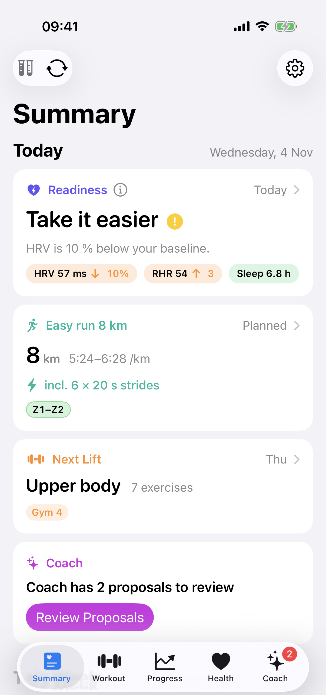
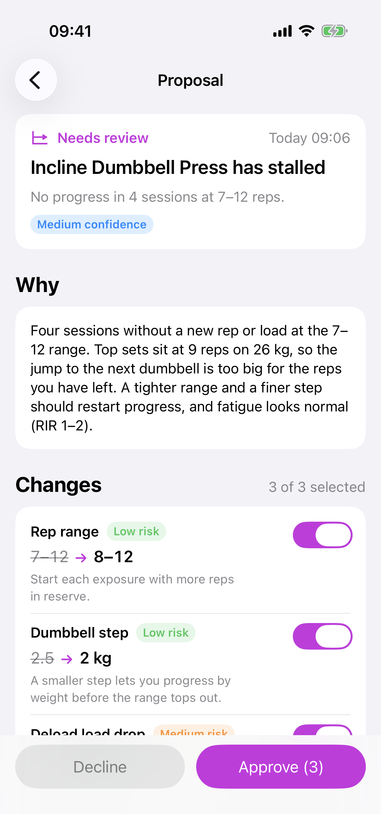
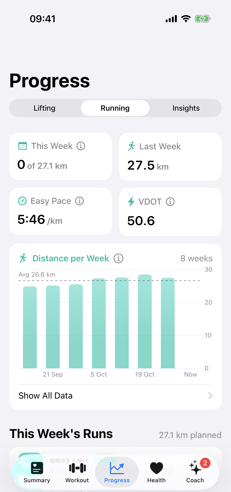

# FitnessBuddy

A training log and planner I built for myself: strength sessions, runs and recovery data go in,
and the app tells me what to do today (which weight, how many reps, what pace). I wanted the
numbers to be predictable, so a plain rule-based engine does the planning. Claude is only used as
an advisor on top: it can read my history and *propose* changes to the engine's settings, and
nothing changes until I approve it.

The data comes from Strong (CSV import), Garmin (activities, sleep, HRV) and Withings (weight).
The app is for one user and runs against my own server, so the screenshots and example payloads
here are generated from a made-up demo database (see "Demo data").

<p>
  
  
  
</p>

## How it fits together

- **Engine** (`backend/apps/fitness/engine/core/`): pure Python, plain data in and out, no database.
  Double progression for lifts (stalls, deloads, retests), a VDOT-based pace model for runs, a
  readiness score from HRV / resting HR / sleep, and rules for moving missed sessions. A layering
  test keeps SQLAlchemy out of it. `engine/store/` loads data and persists the plans.
- **Backend**: FastAPI + SQLAlchemy + SQLite, Alembic migrations, APScheduler for the Garmin and
  Withings syncs. The iOS app talks to it through a push/pull sync API (`docs/api/sync.md`).
- **iOS app** (`ios/`): SwiftUI + SwiftData, offline first: workouts are logged locally and pushed
  when there is a connection. Shared models and logic live in the `FitnessCore` Swift package so
  they can be tested without a simulator.
- **Advisor** (`backend/apps/fitness/advisor/`): builds a summary of the last weeks and asks Claude
  for a structured answer (diagnosis, proposed changes). The answer is never applied directly:
  every proposed change goes through a validator that only accepts engine parameters on an
  allowlist (never a weight, a pace or a heart-rate number), checks the range and the risk level,
  and rejects the rest. Valid changes wait for my approval and become a new, diffable config version
  that can be rolled back.

## An example

Asking the coach about a stalled lift (`docs/api/examples/coach_proposal_detail.json`, trimmed):

```json
{
  "status": "pending",
  "changes": [
    {"id": "p1", "param": "exercise_overrides.triceps_extension.rep_range",
     "from": [7, 12], "to": [8, 12], "risk": "low", "valid": true},
    {"id": "p2", "param": "running.weekly_volume_cap_pct",
     "from": 10, "to": 12, "risk": "high", "valid": true},
    {"id": "p3", "param": "exercise_overrides.triceps_extension.target_weight",
     "from": 30, "to": 35, "valid": false,
     "validation_error": "param is not on the allowlist (only engine parameters can be changed, never weights, paces or heart-rate numbers)"}
  ]
}
```

Approving applies only the valid changes that were selected:

```sh
curl -X POST -H "Authorization: Bearer $TOKEN" -H "Content-Type: application/json" \
  -d '{"change_ids": ["p1"]}' http://localhost:8000/api/v1/coach/proposals/1/approve
```

## Running it

```sh
brew install uv
cd backend
uv sync
uv run alembic -c apps/fitness/alembic.ini upgrade head   # creates backend/var/fitness.db
API_TOKEN=dev uv run uvicorn server:app --reload          # http://localhost:8000/docs with DOCS_ENABLED=true
```

Settings (Garmin and Withings keys, `ANTHROPIC_API_KEY`, scheduler) are environment variables, see
`backend/.env.example`. Importing a Strong export: `docs/spec/decisions.md` (step 2) and
`python -m apps.fitness.importers.strong --help`.

Tests:

```sh
make test          # backend suite (about 1200 tests); make test-fast skips the DB ones
make ios-core-test # FitnessCore package tests, no simulator needed
make ios-test-fast # app tests on the simulator (iPhone 17 Pro)
```

## Demo data

`make demo-data` builds a synthetic database for a fictional lifter and runner
(`apps/fitness/scripts/seed_demo_db.py`, seeded, so it is reproducible) and regenerates
`docs/api/examples/*.json` by calling the real endpoints. The iOS tests decode those files, so
the API contract is checked on both sides. The app's demo mode (debug builds) shows similar made-up
data and is what the screenshots come from.

## Stack

Python 3.12, FastAPI, SQLAlchemy 2, Alembic, SQLite, APScheduler, the Anthropic SDK; Swift 6,
SwiftUI, SwiftData, Swift Charts; Docker + Caddy for the single-VM deployment (`deploy/`). More
detail and the reasoning behind decisions: `docs/spec/decisions.md`.
